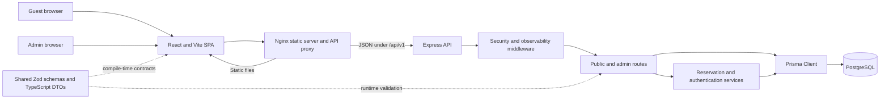
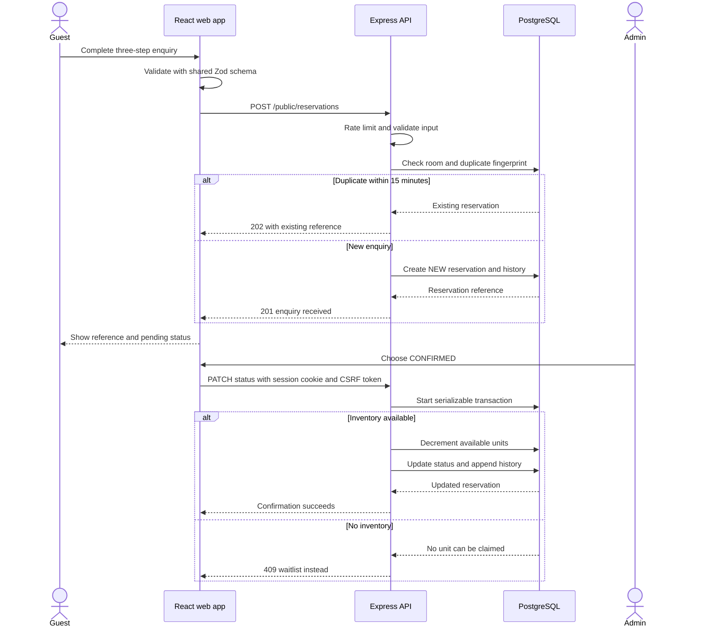
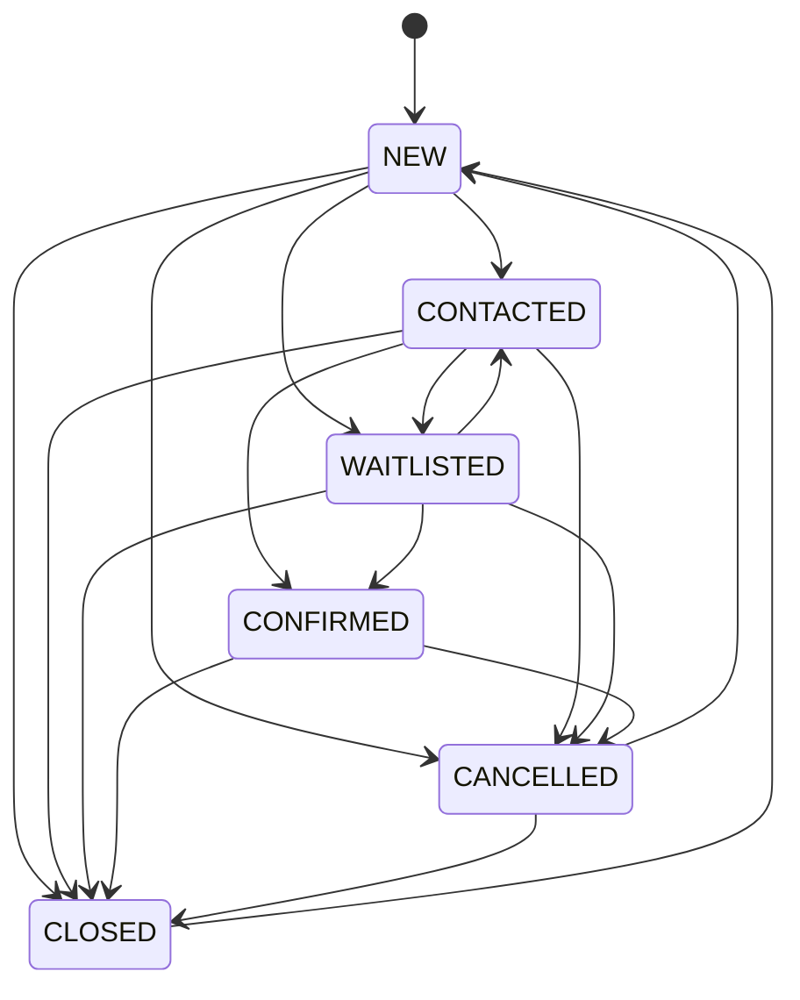
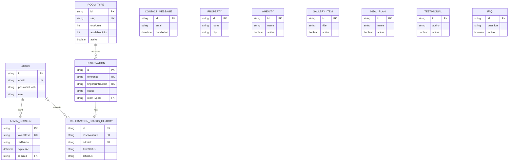

# Verdant House Application Guide

This guide explains what the application does, how its parts communicate, where each responsibility lives, and how to run and change it safely. It is written for developers who are new to this repository. For explanations of the programming language and framework concepts, continue with [Beginner Developer Guide](BEGINNER_DEVELOPER_GUIDE.md).

## 1. What the application is

Verdant House is a paying-guest accommodation enquiry platform with two user experiences:

1. **Public website** for guests to inspect rooms, prices, indicative availability, amenities, meals, photos, testimonials, FAQs, and contact information.
2. **Admin workspace** for house staff to review enquiries, confirm or waitlist reservations, manage contact messages, update room inventory, and edit public content.

An enquiry is deliberately not treated as an instant booking. Inventory is claimed only when an administrator moves an enquiry to `CONFIRMED`.

### Main user roles

| Role | Main capabilities |
| --- | --- |
| Guest | Browse public content, submit a room enquiry, submit a contact message |
| Manager | Sign in, review reservations and messages, change reservation statuses, edit public content |
| Owner | Everything a manager can do, plus change room inventory and property details |

## 2. System architecture



The repository is a **monorepo**: one Git repository contains multiple related packages. npm workspaces install their dependencies together and let the web and API import `@verdant/shared`.

### Runtime request path

In local development, the browser usually calls `http://localhost:4000/api/v1` directly. In the Docker stack, the browser calls `/api/v1` on Nginx, and Nginx proxies that request to the API container.

```text
Browser -> React application -> HTTP request -> Express route -> Prisma -> PostgreSQL
Browser <- React application <- JSON response <- Express route <- Prisma <- PostgreSQL
```

## 3. Repository map

Generated folders such as `node_modules` and `dist` are build outputs, not source code.

```text
.
|-- apps/
|   |-- api/                 Express API and Prisma database layer
|   `-- web/                 React single-page application
|-- packages/
|   `-- shared/              Shared Zod schemas and TypeScript DTOs
|-- docker/
|   `-- nginx.conf           Static hosting, SPA fallback, API proxy
|-- docs/                    Developer documentation
|-- Dockerfile               Multi-stage API and web image build
|-- docker-compose.yml       PostgreSQL, setup, API, and web services
|-- package.json             Workspace scripts and shared tooling
|-- tsconfig.base.json       Strict TypeScript defaults
|-- eslint.config.js         Repository lint rules
|-- PRODUCT.md               Product intent and user principles
|-- DESIGN.md                Visual system and interaction principles
`-- README.md                Quick setup and command reference
```

### Root files

| File | Responsibility |
| --- | --- |
| `package.json` | Defines npm workspaces and commands that run across packages |
| `package-lock.json` | Locks exact installed dependency versions |
| `tsconfig.base.json` | Enables strict TypeScript checks shared by every workspace |
| `eslint.config.js` | Defines static code-quality rules |
| `.env.example` | Documents environment variables without real secrets |
| `.gitignore` | Prevents secrets, dependencies, and build output from being committed |
| `.dockerignore` | Keeps unnecessary and sensitive files out of Docker build context |
| `Dockerfile` | Builds the shared package, API, and web application in stages |
| `docker-compose.yml` | Runs PostgreSQL, migration/bootstrap setup, API, and web containers |
| `PRODUCT.md` | Explains users, purpose, brand personality, and accessibility goals |
| `DESIGN.md` | Explains colors, typography, layout, components, and motion |

### Shared package

| File | Responsibility |
| --- | --- |
| `packages/shared/src/index.ts` | Zod validation schemas, status constants, API data types |
| `packages/shared/src/contracts.test.ts` | Tests shared input contracts |
| `packages/shared/package.json` | Builds the package to `dist` for API and web imports |
| `packages/shared/tsconfig.json` | Emits JavaScript and type declarations |

### API application

| File | Responsibility |
| --- | --- |
| `apps/api/src/index.ts` | Starts the server and handles graceful shutdown |
| `apps/api/src/app.ts` | Creates Express, installs middleware, health routes, routers, and error handling |
| `apps/api/src/config.ts` | Loads and validates environment variables |
| `apps/api/src/db.ts` | Creates the shared Prisma client |
| `apps/api/src/routes.ts` | Defines all public and admin HTTP endpoints |
| `apps/api/src/auth.ts` | Creates, checks, and destroys admin sessions; checks CSRF and owner role |
| `apps/api/src/reservations.ts` | Enforces reservation status transitions and transactional inventory |
| `apps/api/src/errors.ts` | Converts application, Zod, and Prisma errors into stable JSON responses |
| `apps/api/prisma/schema.prisma` | Defines database models, relations, indexes, and enums |
| `apps/api/prisma/migrations/` | Versioned SQL used to create or update the database |
| `apps/api/prisma/seed.ts` | Creates the initial owner and demo property content |
| `apps/api/prisma/bootstrap.ts` | Seeds only when required data is missing |
| `apps/api/src/*.test.ts` | API health and reservation lifecycle tests |

### Web application

| File | Responsibility |
| --- | --- |
| `apps/web/index.html` | HTML shell, metadata, fonts, skip link, and React root element |
| `apps/web/src/main.tsx` | Creates the React root and installs Query and Router providers |
| `apps/web/src/App.tsx` | Maps browser URLs to public and lazy-loaded admin pages |
| `apps/web/src/api/client.ts` | Central fetch wrapper, CSRF handling, errors, and API methods |
| `apps/web/src/api/demo.ts` | Explicit offline showcase data |
| `apps/web/src/pages/PublicHome.tsx` | Complete public marketing experience |
| `apps/web/src/components/ReservationDialog.tsx` | Three-step room enquiry form |
| `apps/web/src/components/ContactForm.tsx` | Public contact form |
| `apps/web/src/pages/AdminLogin.tsx` | Secure staff sign-in page |
| `apps/web/src/pages/AdminApp.tsx` | Admin layout, dashboard, reservations, messages, rooms, and content editors |
| `apps/web/src/styles.css` | Design tokens, layouts, components, responsive rules, dark theme, reduced motion |
| `apps/web/vite.config.ts` | React/Tailwind plugins, bundle splitting, and Vitest browser environment |
| `apps/web/src/test/setup.ts` | Browser API shims used by tests |
| `apps/web/src/pages/PublicHome.test.tsx` | Public rendering and enquiry-dialog test |

## 4. Frontend startup and routing

`apps/web/src/main.tsx` is the browser entry point.

1. `createRoot` attaches React to `<div id="root">`.
2. `StrictMode` highlights unsafe React behavior during development.
3. `QueryClientProvider` gives components access to TanStack Query.
4. `BrowserRouter` reads and updates the browser URL.
5. `App` chooses the page for the current route.

The routes are:

| Browser path | React page |
| --- | --- |
| `/` | `PublicHome` |
| `/admin/login` | `AdminLogin` |
| `/admin/*` | `AdminApp` and its nested admin routes |
| Anything else | Redirect to `/` |

Admin code is loaded with `lazy(...)`, so public visitors do not download the admin page until it is needed.

## 5. Public website behavior

`PublicHome` calls `getSite()` through TanStack Query. The API returns one `PublicSiteDto` containing property information, rooms, amenities, gallery items, meal plans, testimonials, and FAQs.

The page includes:

- responsive navigation and persisted light/dark theme;
- hero and property summary;
- room inventory and price presentation;
- amenity list;
- interactive meal tabs;
- gallery using a native `<dialog>`;
- property story and testimonials;
- native `<details>` FAQ accordions;
- contact information and message form;
- three-step reservation enquiry dialog.

### Loading and failure states

While the request is pending, the page shows skeleton content. If the API fails, the page shows an explicit error. Demo data is returned only when `VITE_USE_DEMO_DATA=true`, which prevents accidental display of fake availability in production.

### Contact form

`ContactForm` uses React Hook Form plus `contactInputSchema`. The hidden `website` input is a honeypot: normal users leave it empty, while simple spam bots often fill it.

On success, the API creates a `ContactMessage`. Admin staff can later mark the message handled or reopen it.

## 6. Reservation enquiry workflow



### Guest submission

1. Step one collects the room, move-in date, and stay length.
2. Step two collects contact details and optional occupation.
3. Step three collects an optional message and required consent.
4. The browser validates with the same Zod contract the API uses.
5. The API verifies the room is active and creates a duplicate fingerprint.
6. Identical enquiries within a 15-minute bucket reuse the existing reference.
7. A new reservation starts in `NEW`; no inventory is consumed yet.

### Reservation state machine



`canTransition` in `reservations.ts` is the source of truth for these arrows. Moving to the same status is also allowed and updates notes without adding another history event.

### Inventory protection

Confirmation runs inside a PostgreSQL **serializable transaction**:

1. Read the reservation.
2. Check that its status transition is allowed.
3. Atomically decrement `availableUnits` only when it is greater than zero.
4. Update the reservation.
5. Append `ReservationStatusHistory`.
6. Return the updated reservation and history.

If PostgreSQL reports a serialization conflict, the service retries up to three times. Leaving `CONFIRMED` returns one unit to inventory.

## 7. Admin authentication and authorization

### Login

1. The login body is validated with `loginInputSchema`.
2. The API looks up the admin by normalized email.
3. `bcrypt.compare` checks the password hash.
4. A random session token and CSRF token are created.
5. Only a SHA-256 hash of the session token is stored in PostgreSQL.
6. The raw token is returned in an HTTP-only cookie.
7. The CSRF token is returned in JSON and held only in browser memory.

The session lasts eight hours. Creating a session deletes expired sessions and previous sessions for the same admin.

### Protected requests

`requireAdmin` hashes the cookie token, finds the database session, checks expiry, and attaches the admin and session to `response.locals`.

For non-read methods, `requireCsrf` compares the `x-csrf-token` header to the session token using a timing-safe comparison. `requireOwner` protects room mutations and property updates.

### Session expiry in React

The API client dispatches a `verdant:session-expired` browser event after an admin `401`. `AdminShell` listens for that event and returns the user to the login page.

## 8. API middleware order

Middleware order matters because each layer prepares or protects the next:

1. Disable `x-powered-by`.
2. Configure trusted proxies only when requested.
3. Add Pino request logging and request IDs.
4. Redact cookies, passwords, and set-cookie headers from logs.
5. Add Helmet security headers.
6. Apply CORS allow-listing.
7. Parse JSON with a 64 KB limit.
8. Parse cookies.
9. Apply the global rate limit.
10. Register health, public, and admin routes.
11. Return a JSON 404.
12. Convert thrown errors to stable JSON.

## 9. API reference

All application routes are under `/api/v1`.

### Public routes

| Method | Path | Purpose |
| --- | --- | --- |
| `GET` | `/public/site` | Fetch all public site content |
| `GET` | `/public/rooms` | Fetch active room types |
| `POST` | `/public/reservations` | Submit a reservation enquiry |
| `POST` | `/public/contact` | Submit a contact message |

### Admin authentication

| Method | Path | Purpose |
| --- | --- | --- |
| `POST` | `/admin/auth/login` | Authenticate and create a session |
| `GET` | `/admin/auth/me` | Restore the current admin and CSRF token |
| `POST` | `/admin/auth/logout` | Delete the session and clear the cookie |

### Admin operations

| Method | Path | Purpose |
| --- | --- | --- |
| `GET` | `/admin/dashboard` | Counts, inventory totals, recent enquiries |
| `GET` | `/admin/reservations` | Search, filter, and paginate reservations |
| `PATCH` | `/admin/reservations/:id/status` | Change status and inventory transactionally |
| `GET` | `/admin/messages` | Paginate contact messages |
| `PATCH` | `/admin/messages/:id` | Mark a message handled or open |
| `GET` | `/admin/rooms` | List all room types |
| `POST` | `/admin/rooms` | Create a room type; owner only |
| `PATCH` | `/admin/rooms/:id` | Edit inventory; owner only |
| `DELETE` | `/admin/rooms/:id` | Archive a room type; owner only |
| `GET` | `/admin/property` | Read property profile |
| `PATCH` | `/admin/property` | Edit property profile; owner only |
| `GET` | `/admin/content/:type` | List one content type |
| `POST` | `/admin/content/:type` | Create content |
| `PATCH` | `/admin/content/:type/:id` | Edit content |
| `DELETE` | `/admin/content/:type/:id` | Archive content by setting `active=false` |

Supported content types are `amenities`, `gallery`, `meal-plans`, `testimonials`, and `faqs`.

## 10. Database design



### Core tables

| Model | Purpose |
| --- | --- |
| `Admin` | Staff identity, password hash, role, active flag |
| `AdminSession` | Server-side login session and CSRF token |
| `RoomType` | Price, capacity, total units, available units, visibility |
| `Reservation` | Guest enquiry and current operational status |
| `ReservationStatusHistory` | Audit trail of status changes |
| `ContactMessage` | Public contact submission and handled timestamp |
| `Property` | Single-property identity and contact information |
| `Amenity`, `GalleryItem`, `MealPlan`, `Testimonial`, `Faq` | Editable public content |

The current schema assumes one property, so content and rooms do not carry a `propertyId`. Add that relation before turning the application into a multi-property platform.

### Important constraints

- Admin emails, room slugs, reservation references, session hashes, and fingerprint buckets are unique.
- `availableUnits` cannot be negative or exceed `totalUnits`.
- Foreign keys connect reservations to rooms and history to reservations/admins.
- Indexes support active-content sorting, session expiry, reservation filtering, and history lookup.

## 11. Error response format

The API uses a stable shape:

```json
{
  "error": {
    "code": "VALIDATION_ERROR",
    "message": "Please check the highlighted information.",
    "requestId": "request-correlation-id",
    "fieldErrors": {
      "email": ["Invalid email address"]
    }
  }
}
```

Expected application errors become their intended HTTP status. Zod errors become `400`. Missing Prisma records become `404`. Unexpected errors are logged and returned as a generic `500` without leaking internal details.

## 12. Styling and accessibility

`styles.css` is organized as:

1. CSS custom properties for colors, fonts, shadows, and z-index layers.
2. Dark-theme token overrides.
3. Reset and accessibility utilities.
4. Shared buttons and form controls.
5. Public page sections.
6. Dialogs and login.
7. Admin shell and admin components.
8. Responsive breakpoints.
9. Reduced-motion override.

Accessibility features include:

- a keyboard-visible skip link;
- semantic landmarks;
- native dialogs and details elements;
- labels and field-level errors;
- visible focus rings;
- 44-pixel minimum interactive controls;
- alt text for meaningful images;
- status text in addition to color;
- `prefers-reduced-motion` support.

## 13. Local development

### Prerequisites

- Node.js 22 or newer
- npm 10 or newer
- PostgreSQL 15+ or Docker Desktop

### Setup

```powershell
Copy-Item .env.example .env
# Edit .env and set ADMIN_PASSWORD and SESSION_SECRET.
docker compose up -d postgres
npm install
npm run db:generate
npm run db:migrate
npm run db:seed
npm run dev
```

Open:

- Web: `http://localhost:5173`
- API: `http://localhost:4000`
- API liveness: `http://localhost:4000/health`
- API readiness: `http://localhost:4000/ready`

`/health` only proves that the server process responds. `/ready` also checks PostgreSQL.

## 14. Docker stack

```powershell
Copy-Item .env.example .env
# Set secure local values in .env.
docker compose up --build -d
```

Compose starts:

| Service | Responsibility |
| --- | --- |
| `postgres` | PostgreSQL database and persistent volume |
| `setup` | One-shot migration and conditional bootstrap |
| `api` | Production Express process |
| `web` | Nginx serving the Vite build and proxying `/api/` |

The Dockerfile has three stages:

1. `build` installs dependencies, generates Prisma Client, and builds all workspaces.
2. `api` copies production API output and Prisma files into a Node image.
3. `web` copies the browser bundle into Nginx.

Nginx uses `try_files ... /index.html`, which is required for client-side routes such as `/admin/login`.

## 15. Environment variables

| Variable | Used by | Meaning |
| --- | --- | --- |
| `DATABASE_URL` | API/Prisma | PostgreSQL connection string |
| `PORT` | API | HTTP port |
| `NODE_ENV` | API | Development, test, or production behavior |
| `WEB_ORIGIN` | API | Comma-separated CORS allow-list |
| `SESSION_SECRET` | API/deployment | Required secret configuration |
| `TRUST_PROXY_HOPS` | API | Number of trusted reverse proxies |
| `ADMIN_EMAIL` | Seed/bootstrap | Initial owner email |
| `ADMIN_PASSWORD` | Seed/bootstrap | Initial owner password; minimum 14 characters |
| `VITE_API_URL` | Web build | API base URL visible to browser code |
| `VITE_USE_DEMO_DATA` | Web build | Explicit offline showcase mode |

Values prefixed with `VITE_` are compiled into browser JavaScript. Never place secrets in them.

## 16. Testing and quality commands

```powershell
npm run typecheck
npm run lint
npm test
npm run build
```

| Command | What it catches |
| --- | --- |
| `typecheck` | Incorrect TypeScript usage without running the app |
| `lint` | Suspicious or inconsistent code patterns |
| `test` | Contract, lifecycle, health, and public UI regressions |
| `build` | Production compilation and bundling problems |

Vitest runs Node tests for the API/shared package and jsdom browser-like tests for React. Testing Library interacts with the page through accessible roles rather than component internals.

## 17. Common change recipes

### Add a public content type

1. Add a Prisma model and migration.
2. Add its Zod schema and route delegate in `routes.ts`.
3. Add its DTO to `PublicSiteDto`.
4. Fetch it in `publicSite()`.
5. Render it in `PublicHome`.
6. Add admin metadata and fields in `AdminApp`.
7. Add seed data and tests.

### Add a reservation status

1. Add it to Prisma `ReservationStatus`.
2. Add it to `reservationStatuses` in the shared package.
3. Update `allowedTransitions`.
4. Update admin labels and styles.
5. Create a migration.
6. Add lifecycle tests.

### Add a new API endpoint

1. Define or reuse a Zod request schema.
2. Add the Express route.
3. Decide whether it needs admin, CSRF, and owner middleware.
4. Return stable DTOs instead of database secrets.
5. Add the web client method.
6. Add tests for success and failure.

### Change the visual theme

Start with CSS variables at the top of `styles.css`, then update `DESIGN.md`. Avoid replacing semantic tokens with repeated hard-coded colors.

## 18. Current boundaries

The application intentionally does not include:

- payments or receipts;
- resident user accounts;
- email, SMS, or WhatsApp automation;
- real-time chat;
- image upload/storage;
- date-range room allocation;
- multi-property tenancy.

`availableUnits` is a current operational counter, not a calendar-based availability engine. A production system with future overlapping stays should model individual room units and occupancy date ranges.

